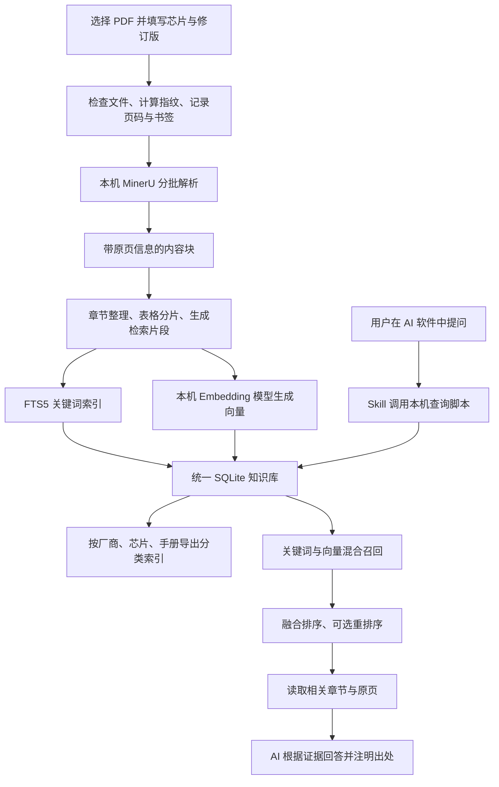

# 芯片手册知识库：MinerU、自动向量化与 Skill 检索原理

文档日期：2026-10-30（北京时间）  
对应实现：ChipManualDesk 1.0.2，本机自部署 MinerU 方案  
读者：希望理解系统如何工作、如何维护，以及如何继续扩展的使用者。

本文以本项目当前源码和本机安装配置为依据。文中的“已经实现”描述现有程序；“可以扩展”描述后续方向，不代表当前已有该功能。

## 0. 本次整合变更（相对 1.0.2）

> 记录 2026-10 定向学习后落地、并已整合进本项目的变更。均以 `config.json` 开关控制，**默认行为与 1.0.2 一致**。详见同目录 `落地说明.md`。

- **检索层 Eval 框架**（`eval/`）：`run_eval.py` 跑黄金集（`golden.json`），确定性评测 recall@k、章节定位、页码引用、版本约束、过滤，并按类别分域报告（不看总平均）。
- **向量检索向量化**：`retrieval.py` 的暴力扫描由「逐行 Python 循环」改为「一次 numpy 矩阵乘法」，常量级提速（复杂度仍是 O(V×D)）。
- **双后端加载器**：`embedding_backend` / `reranker_backend` 支持 `fastembed`（默认）与 `sentence-transformers`。换 bge-m3 / bge-reranker-v2-m3 必须走 sentence-transformers（FastEmbed 不支持，已核实）。
- **跨页表格合并门控**：`cross_page_table_cell_merge`（默认 false）开启 MinerU 的 llm_aided 跨页单元格合并；离线替代为 Camelot 2.0 的 `stack_contiguous()`（需回原 PDF 重解析，未默认接入）。
- **本地图打标门控**：`image_captioning`（默认 false）+ `chiprag/caption.py`，用 Qwen2.5-VL 本地给波形/架构图生成文字描述入库（Qwen2-VL 已被取代）。
- **Agentic SKILL.md 强化**：`integration.py` 生成模板新增「迭代检索 + 数值条件核验」规则。

> **验证边界**：以上改动均通过 `py_compile` 与 eval `--self-test`；但未在本机真实索引上端到端运行。启用新功能前，先跑 Eval 基线再逐个开关对比（数据先行，勿凭感觉换）。

## 1. 这套系统完成什么工作

你提供一份芯片手册 PDF，系统在本机解析页面，提取文字、表格、标题和图片关联信息，整理成能够追溯原页的内容片段，然后自动建立关键词索引和向量索引。

以后你向支持本机脚本的 AI 软件提问，Skill 引导 AI 调用本机检索程序，先找到相关手册片段，再按需要查看完整章节或原页图片，最后根据证据回答。

整个过程分为两条流程：

| 流程 | 何时执行 | 主要工作 |
|---|---|---|
| 手册入库 | 新增或更新手册时 | PDF 检查、分批解析、内容分块、向量化、保存索引 |
| 提问检索 | 每次提问时 | 确定芯片和版本、查找片段、核验原文、生成答案 |

入库完成后，日常提问不必重新解析几千页 PDF，也不必重新向量化整本手册。每个问题仍需要计算问题本身的向量，才能与已经保存的内容向量比较。

## 2. 整体架构



系统的职责可以分成四层：

1. **桌面界面**：选择文件、填写手册信息、启动任务、显示进度和日志。
2. **本机处理程序**：执行解析、索引、检索、原页渲染和分类导出。
3. **本机数据目录**：保存原 PDF、解析结果、模型和索引。
4. **宿主 AI 与 Skill**：理解问题、调用检索工具、核验材料并组织回答。

EXE 负责提供桌面入口，耗时任务由独立 Python 子进程执行。几 GB 的模型位于独立数据目录中，没有全部塞进 EXE。

## 3. RAG 是什么，为什么适合芯片手册

RAG 的英文是 Retrieval-Augmented Generation，通常译为“检索增强生成”。工作顺序是：先从资料库寻找相关证据，再让生成模型参考证据回答。

芯片手册非常适合这种方式，因为你往往只需要一本几千页手册中的少数几页：某个寄存器的位定义、一张时序表、某个引脚的复用功能，或者某项参数的适用条件。

直接让模型凭已有知识回答，容易遇到型号、修订版和参数条件不一致的问题。把整本手册一次送给模型，也会增加输入量，而且不便于稳定追踪原始出处。RAG 将查找范围缩小到相关证据，同时保留回到原页核验的路径。

这里没有训练一个新的芯片专家大模型。入库是在建立外部知识库；模型权重不会因为导入手册而改变。手册更新时，通常更新该手册的解析结果和索引即可。

## 4. “自动向量化”是否需要 AI

需要使用已经训练好的模型，但不需要人工逐段操作，也不需要每次请聊天模型阅读整本手册。

当前系统有三类不同的模型工作：

| 工作 | 当前承担者 | 输出 | 是否需要你提供云端 API Key |
|---|---|---|---|
| PDF 页面解析 | 本机 MinerU，ONNX 小模型与 llama.cpp 视觉模型 | 页面结构、文字、表格及图片关联信息 | 不需要 |
| 内容向量化 | 本机 FastEmbed 加载多语言 Embedding 模型 | 一组数值向量 | 不需要 |
| 候选内容重排序 | 本机英文 Cross-Encoder 模型 | 候选相关性排序 | 不需要 |
| 理解问题并生成回答 | 你使用的 Codex、Claude Code 等宿主 AI | 自然语言答案 | 按宿主软件本身的使用方式运行 |

“自动”的含义是：模型和环境准备好后，程序可以连续处理所有片段，无需你逐段提示。向量化仍然在运行神经网络推理，只是它输出数字表示，而不是一段聊天回复。

首次安装和模型下载通常需要联网。本地模型准备完整后，本项目的解析、向量化和检索设计为本机执行。最终回答是否使用网络，由宿主 AI 决定；本地入库不等于整条问答链路都离线。

## 5. 第一步：检查 PDF 并建立手册身份

### 5.1 保存什么信息

导入时，程序首先确认文件存在且为 PDF，然后读取页数、书签和页标签，记录芯片型号、修订版、手册名称和可选的型号别名、厂商。

程序计算整个 PDF 的 SHA-256 指纹，再结合芯片、修订版、标题、解析档位、分批参数、MinerU 版本和相关配置，生成内部文档 ID。这样，相同输入与相关配置能够复用已有任务；文件或关键配置变化后，可以区分不同处理结果。

当前内部 ID 使用组合身份的 SHA-256 前 20 个十六进制字符。它是程序的管理标识，不是手册官方编号。

原 PDF 会复制到该手册自己的目录，后续引用指向这份保存的原件。即使下载文件夹中的原始文件被移动，已保存的手册仍有原文来源。

### 5.2 芯片与版本信息来自哪里

当前导入流程以你填写的元数据为准，尚未实现可靠的自动芯片识别和自动版本识别。

例如，`STM32H743` 可以作为型号别名，关联到一本同时覆盖多个 STM32H7 型号的手册。检索过滤时，程序既检查手册主型号，也检查别名。

这不会自动判断某一段内容是否适用于所有别名。遇到不同芯片、封装或硅版本的差异，仍须读取正文中的适用范围。

### 5.3 加密 PDF 如何处理

PDF 的“加密标记”可能对应两种情况：无需输入密码即可打开，但带编辑或复制权限限制；或者确实需要输入打开密码。

1.0.2 修复了“一看到加密标记就拒绝”的检查方式。现在只尝试标准空密码：能够读取就继续导入；不能读取则提示先用正确密码打开，另存为无需密码的副本。

程序不会猜测密码。保存的原 PDF 仍为源文件的原样副本，没有额外生成解除限制后的 PDF。该修复已通过空打开密码、带所有者密码的 AES-256 样本实际解析验证。

## 6. 第二步：几千页 PDF 如何自动拆分

### 6.1 拆分的是解析任务范围

当前程序默认每批处理 50 个核心页面，并在两侧各保留最多 1 页上下文。通常不必先生成几十个独立的小 PDF；程序向 MinerU 传入原文件及页码范围。

例如一本 3000 页的手册，核心任务大致分为 60 批：

| 批次 | 最终负责的核心页 | 交给解析器的页范围 |
|---|---|---|
| 第 1 批 | 1–50 | 1–51 |
| 第 2 批 | 51–100 | 50–101 |
| 第 3 批 | 101–150 | 100–151 |
| 最后一批 | 2951–3000 | 2950–3000 |

边缘页给解析器提供局部上下文，合并时只收取每批核心范围内的内容。因此同一原页最终由一批负责，不会因为重叠解析而重复入库。

这个重叠机制不能保证恢复所有跨页表格。长表格、复杂表头、跨页脚注仍可能需要核验。

### 6.2 为什么要分批

分批能限制单次任务规模，缩小失败后需要重做的范围，并让系统在批次完成后保存进度。它也为安全暂停提供边界。

当前程序通过本机文件锁限制同一知识库一次运行一个解析任务，避免多个大任务同时争用资源。批次按顺序处理。MinerU 内部还有页面窗口和并发参数，它们与外层“每批 50 页”是不同层次的设置。

### 6.3 失败后如何重试

每批失败后会进行有界重试。当前逻辑在同一批累计尝试两次后，如果核心范围超过一页，就将该范围分成两个更小的任务继续处理。

如果缩小到单页核心范围后仍持续失败，任务会停止并保留错误，不会无限重试，也不会悄悄跳过该页继续宣布整本完成。

每批的输出目录保留解析日志，可定位具体失败范围。已经标记完成且存在结果的批次会被复用。

### 6.4 怎样避免页码错乱

MinerU 每批解析完成后，程序检查输出页索引是否恰好覆盖请求范围，并检查内容块所属页是否有效。映射不符时拒绝继续索引。

内部页面索引从 0 开始，例如 `page_idx=0` 表示 PDF 第 1 页；对外引用的 `page` 从 1 开始。系统还记录 PDF 页标签及识别出的印刷页码，因为“文件第 100 页”与“页脚写着 98”可能不同。

当前 `parsed_pages` 代表通过页范围验证的解析覆盖数量，不代表每页文字都被完全、正确识别。

## 7. 第三步：MinerU 实际解析出什么

当前桌面程序使用本机 SDK 调用 MinerU，默认档位为 `standard`，小模型后端配置为 ONNX，视觉模型引擎配置为 llama.cpp。

程序保存 MinerU 的结构化结果，再将其转换为 Content List，供后续分块使用。主要材料包括文字块、标题、表格、图片和图表相关信息；具体质量受 PDF 类型、扫描清晰度和页面复杂度影响。

当前可见的关键产物包括：

| 文件 | 用途 |
|---|---|
| `middle_json.json` | MinerU 结构化解析结果 |
| `blocks.json` | 本项目使用的内容块列表 |
| `pages.json` | 该批实际返回的原始页面索引 |
| `parse.log` | 解析日志及错误定位信息 |
| 图片等附件 | 与内容块关联的本机资源 |

### 7.1 文字型与扫描型 PDF

文字型 PDF 可能包含可读取的文本；扫描型 PDF 的正文主要位于页面图像中，需要识别。实际处理方式由当前 MinerU 解析档位与页面内容共同决定，不能仅按“PDF”文件扩展名判断难度。

### 7.2 图片是否进入向量库

当前检索端使用的是**文本向量模型**，不是图像向量模型。

图片或图表如果有可用图注、关联文字，这些文字会参与分块和文本检索。程序也保存图片路径、资源目录和原页信息；没有可用文字时，可能生成提示查看原页的占位内容。

因此，“能够提取图片”不等于“能够通过任意视觉内容准确搜索图片”。纯波形图、模拟曲线、复杂框图的视觉语义，目前没有独立建立图像向量索引。

处理这类问题时，先用图注、信号名称、章节标题找到页面，再渲染原页交给具备图像阅读能力的宿主 AI 核验。若需要按图搜图或系统性理解全部曲线，可后续增加多模态索引或经过验证的图像描述流程。

## 8. 第四步：为什么还要把内容分成片段

解析任务的“50 页一批”解决任务管理问题。检索片段的“约 1400 字符”解决内容查找与上下文组织问题。两者不是同一种拆分。

如果把整章保存成一个检索单元，一次命中可能带回大量无关文字；如果只保存过短的句子，又容易丢失寄存器所属外设、参数适用条件和脚注。当前程序以 MinerU 内容块为基础，结合章节信息生成片段。

### 8.1 普通文本

文本优先在换行、句号或分号附近拆分；缺少合适边界时按长度切开。过长文本拆分时保留约 100 字符重叠，降低边界附近内容被割裂的影响。

`chunk_characters=1400` 是默认分块目标，不是所有产物的严格长度上限。例如保留完整表格行、表头和脚注后，某个片段可能更长。

### 8.2 章节层级

程序结合 PDF 书签、解析出的标题和章节编号维护章节路径，例如：

```text
外设章节 / ADC / 时钟配置
```

同一章节的片段共享父级标识，检索命中一个片段后，可以继续读取同一章节的其他片段。

当前没有启用 MinerU 的外部 LLM 辅助标题层级修正。复杂排版、错误标题识别和异常书签可能造成章节路径不准确，需要在原文中核对。

### 8.3 表格

表格按 HTML 行提取，分片时重复携带表题和第一行表头，并附带表格脚注，尽量避免出现“找到了数值，却不知道属于哪一列”的问题。

当前实现将首行作为表头上下文，这并不能完整解决多层表头、合并单元格和所有跨页布局。程序对部分相邻、同章节、同表号的表格片段建立前后关联，但没有启用全面的跨页表格单元格合并。

### 8.4 片段保留哪些字段

| 字段 | 含义 |
|---|---|
| `id`、`doc_id` | 片段与所属手册的标识 |
| `parent_id`、`section` | 章节归属及路径 |
| `text`、`type` | 文本内容与块类型 |
| `chip`、`revision`、`title` | 芯片、修订版和手册名称 |
| `page`、`page_label` | PDF 文件页码及可用的页标签 |
| `source_pdf` | 保存的原始 PDF 路径 |
| `bbox` | 解析结果提供的位置坐标 |
| `page_notes` | 同页脚注材料 |
| `asset_root`、`image_path` | 关联资源目录和图片路径 |
| `related_previous`、`related_next` | 存在时用于关联表格续片 |

向量只是其中一种索引。正文、页码和出处仍然保存在片段记录中。

## 9. 第五步：向量化如何工作

### 9.1 从文字到数字

Embedding 模型把一段文字映射为固定维度的数字数组。可以把它理解为一种方便计算语义相似度的表示。

例如，“ADC 的时钟来自哪里”和“ADC clock source selection”用词不同，多语言模型有机会将它们映射到较接近的位置。它不保证所有中英文技术表达都能正确匹配，因此本项目同时保留精确关键词检索。

当前向量模型为：

```text
sentence-transformers/paraphrase-multilingual-MiniLM-L12-v2
```

由 FastEmbed 在本机加载缓存模型运行。系统不需要为每个内容片段调用云端聊天 API。

### 9.2 为什么一个片段可能有多个向量

检索片段可能较长，而模型一次输入长度有限。当前程序读取实际 tokenizer 的子词位置，将“章节上下文＋片段正文”进一步拆成向量窗口：每个窗口最多 110 个正文 token，相邻窗口重叠约 20 个 token。

字符数与 token 数不同，中文、英文、寄存器名的分词长度也不同，因此这里使用实际 tokenizer 计算位置，避免简单按字符数假定输入长度。

一个片段可以对应多个向量。检索时，程序使用该片段所有窗口中最高的相似度作为片段的向量匹配分数，返回的仍是完整片段及出处。

### 9.3 相似度怎样计算

设问题向量为 `q`，内容窗口向量为 `v`。程序将向量归一化后计算点积：

```text
q_normalized = q / ||q||
v_normalized = v / ||v||
similarity = q_normalized · v_normalized
```

这对应归一化向量的余弦相似度。问题使用模型的 query embedding 接口生成向量，内容使用文档 embedding 接口生成向量。

相似度用于候选排序，不能解释为“答案正确率”。很接近的问题可能分别对应不同芯片版本、不同电压条件，必须结合过滤和原文核验。

### 9.4 如何保存与恢复向量进度

每个窗口的向量以归一化的 float32 数组保存为 SQLite 二进制字段，关联片段 ID 和模型名称。

入库过程中还维护独立的 `embedding-checkpoint.sqlite3`。检查点根据模型名称、窗口文本及归属生成签名；匹配时可复用已有向量，内容变化后重新计算。

当前每累计 128 个向量提交一次检查点，正常完成和安全暂停时也会提交。突然断电可能需要重做最近尚未提交的一小段；它不会保证每个刚计算完成的向量都立即落盘。

向量和索引完成保存、分类导出后，临时向量检查点会被清理。更换 Embedding 模型通常需要重建对应向量；即使两个模型输出维度相同，也不能假设向量空间兼容。

## 10. 第六步：为什么同时使用关键词检索

芯片手册包含大量必须精确区分的符号，例如寄存器名、位名、地址和型号。只使用向量相似度，可能把“意思相近但具体符号不同”的内容排在一起。

当前程序使用 SQLite FTS5 建立关键词索引，通过 BM25 排序。英文与数字按字母数字及下划线提取词项；连续中文生成相邻双字词项。

例如：

| 查询类型 | 较有帮助的检索方式 |
|---|---|
| `RCC_D1CCIPR` 等具体寄存器 | 关键词检索 |
| “ADC 时钟源如何选择” | 语义向量检索 |
| 中文问题查英文手册 | 多语言向量＋英文技术表达辅助 |
| 某个精确地址或位名 | 保留原符号的关键词检索，并核验上下文 |

目前关键词不是任意子串搜索。输入不完整的寄存器片段时，不一定能像编辑器的全文查找一样匹配完整词项。

## 11. 第七步：一次提问的完整检索过程

### 11.1 先过滤手册范围

程序支持按芯片主型号或别名、修订版、文档 ID 过滤。过滤条件在关键词召回和向量比较时都生效。

这一步非常重要。同一个寄存器名称可能出现在多个系列，旧版手册也可能保留已修改的描述。优先锁定正确手册，能减少混用资料的风险。

### 11.2 两路召回候选

关键词一路取 BM25 排序靠前的候选；向量一路比较符合过滤范围的向量窗口，按片段的最佳相似度排序。默认每路候选数量为 30。

当前向量搜索是对过滤后的向量逐一比较，使用 SQLite 存储和 NumPy 计算，没有使用 FAISS、HNSW 或其他近似最近邻索引。其主要比较量随向量数量与维度增长，约为 `O(V × D)`。

这让当前部署结构较简单，但库规模增长时需要关注查询耗时和内存。程序也会加载过滤范围内的片段元数据，所以应尽量使用芯片、修订版或文档过滤。

### 11.3 使用 RRF 融合排序

关键词分数和向量相似度不在同一数值尺度上。程序按照候选在两路列表中的名次进行 Reciprocal Rank Fusion，简称 RRF：

```text
fusion_score(chunk) = Σ 1 / (60 + rank)
```

`rank` 从 1 开始。一个片段同时在两路排得较高时，会获得更多融合分数。融合后默认保留最多 30 个候选，继续进行可选重排序。

### 11.4 可选的英文重排序

当前模型为：

```text
Xenova/ms-marco-MiniLM-L-6-v2
```

它将问题与每条候选正文配对计算相关性，重新排列候选顺序。这比逐条扫描全库更适合放在召回之后。

当前重排序模型用于英文技术查询。中文问题如果没有提供 `--english-query`，程序使用多语言向量与融合结果，并返回提示；提供忠实的英文改写后，使用英文改写进行重排序。英文改写还会补充关键词召回，但原问题仍用于生成查询向量。

英文改写由调用方或宿主 AI 提供，本机检索器没有自动调用云端翻译。改写必须保留型号、寄存器名、位名和地址。

### 11.5 返回候选，再扩展上下文

默认返回前 8 条，用户可以调整。结果包括片段正文、手册信息、章节、页码、源 PDF 和排序信息。

`retrieval_score` 是融合分数，即使执行过重排序也仍表示融合阶段的分数；它不是最终答案置信度。

命中片段后，Skill 可以继续读取同一章节，跟随分页读取后续片段，或沿表格前后关联查找续表。对于数值、位域和图示，再渲染原页核验。

前 8 条结果不代表所有证据。问题涉及初始化、时钟来源、最大频率和电气条件时，应分别查询相关方面，再整理证据。

## 12. 文件和向量具体存在哪里

本机当前安装目录为：

```text
C:\Users\YiBai\Documents\Codex\ChipManualDesk
```

固定知识库目录为：

```text
C:\Users\YiBai\Documents\Codex\ChipManualLibrary
```

这是本机安装选择的路径，不代表所有电脑安装后都必须使用相同用户名或目录。

```text
ChipManualLibrary/
├── models/                         本地解析、向量和重排序模型
├── manuals/
│   └── 文档ID/
│       ├── source.pdf              保存的原始 PDF
│       ├── manifest.json           元数据、任务状态、进度与质量记录
│       ├── parsed/                 每批解析结果及附件
│       ├── blocks.json             合并后的内容块
│       ├── chunks.json             检索片段
│       └── embedding-checkpoint.sqlite3  向量化期间的恢复检查点
├── index.sqlite3                   日常查询使用的统一索引
├── collections/
│   ├── 厂商/
│   │   └── 芯片/
│   │       └── 手册名--ID前缀/
│   │           ├── index.sqlite3   单本手册的分类索引快照
│   │           └── manual.json     分类条目的元数据与原文位置
│   └── catalog.json                运行整理操作时生成的分类目录清单
├── previews/                       原页或裁剪区域预览
├── backups/skills/                 更新前的 Skill 备份
├── logs/                           日志目录
├── cache/                          缓存
├── tmp/                            临时文件与暂停标记
└── installation-report.json         安装与迁移报告
```

`embedding-checkpoint.sqlite3` 只在需要时存在；其他文件也会随任务阶段逐步生成。

### 12.1 统一索引和分类索引是什么关系

统一索引服务日常检索。每本手册索引完成后，程序从统一索引导出该手册的独立数据库，放进厂商、芯片、手册三级目录，方便管理、核对和备份。

分类目录使用已填写的厂商与芯片信息，并清理 Windows 文件名中的非法字符。当前没有用 AI 自动判断所有手册应该归入哪个芯片目录。

分类数据库含该手册的片段、关键词索引、向量和型号别名，但引用的原 PDF 与附件仍位于 `manuals` 目录。只复制分类数据库并不等于复制了一份包含全部原文资产的可迁移知识库。

分类快照会额外占用空间。当前查询程序仍读统一索引，没有自动切换为直接遍历各个分类数据库。`catalog.json` 在安装或执行整理操作时刷新，可能不是每次单本入库后的即时清单。

### 12.2 数据库里主要有哪些表

| 表 | 内容 |
|---|---|
| `chunks` | 片段正文、页码、章节和来源等 JSON 记录 |
| `search` | FTS5 关键词索引 |
| `vectors` | 片段 ID、模型名称和 float32 向量二进制数据 |
| `chip_aliases` | 文档与型号别名的关系 |

统一数据库启用 WAL 模式。备份正在使用的库时，应使用 SQLite 一致性备份，或先安全停止相关任务；不要只随手复制主数据库文件而忽略尚在 WAL 中的写入。

## 13. Skill 怎样让 AI 使用本机知识库

### 13.1 Skill 承担什么作用

Skill 是提供给宿主 AI 的任务说明和配套资源，告诉它什么时候查手册、如何运行脚本、怎样读取结果以及如何标注出处。官方将 Skill 描述为指令及资源组成的可复用工作流；本项目将确定性的检索工作放在脚本中执行。[OpenAI 官方 Skill 概念说明](https://developers.openai.com/plugins/concepts/skills)、[官方构建说明](https://developers.openai.com/plugins/build/skills)。

向量库不会因安装 Skill 就被全部上传到模型，也不会变成模型权重。Skill 引导宿主调用本机查询工具，工具再返回相关证据。

当前生成的目录包含：

```text
chip-manual-rag/
├── SKILL.md
├── scripts/
│   └── query.ps1
├── agents/
│   └── openai.yaml
└── chipmanual-managed.json
```

`SKILL.md` 规定查找和引用流程；`query.ps1` 定位本机环境并调用检索程序；`agents/openai.yaml` 提供界面元数据；管理标记记录应用和库的位置。

### 13.2 本机脚本如何找到正确知识库

辅助脚本固定使用已安装的 Python 和后端目录，并设置 `CHIPRAG_DATA` 指向知识库。这样不会仅因为 AI 当前工作目录不同，就误查另一个空库。

数据目录解析优先级是：环境变量 `CHIPRAG_DATA`、后端 `installation.json`、最后才是源码项目自己的 `data` 目录。

Skill 辅助脚本仅允许以下四类操作：

| 操作 | 作用 |
|---|---|
| `status` | 列出手册、型号、版本和状态 |
| `search` | 检索片段 |
| `read` | 读取片段或同章节内容 |
| `page` | 将原 PDF 指定页渲染成图片供核验 |

新增手册由桌面软件完成。宿主软件的目录和脚本权限仍然生效，Skill 不会绕过权限设置。

### 13.3 自动配置支持哪些软件

| 软件 | 当前实现 |
|---|---|
| Codex | 检测后安装或更新个人 Skill；本机使用已有的 `.codex/skills` 目录 |
| Claude Code | 检测后安装到 `.claude/skills` |
| Claude 普通桌面聊天 | 可检测部分常见安装位置，当前不自动接通本机查询 |
| Cursor、Windsurf | 可检测部分常见安装迹象，当前不自动写入其配置 |

检测依赖 PATH 和常见目录，可能遗漏便携或非标准安装。更新已有 Skill 时先保存备份，不修改其他技能及账号设置。

本项目当前使用本机脚本集成，没有额外部署 MCP 检索服务器。安装后建议在新聊天中调用，让宿主重新发现 Skill。

### 13.4 一次查询示例

你可以在支持该 Skill 的 AI 聊天中输入：

> 使用 $chip-manual-rag 查询 RM0433 Rev 9：STM32H743 的 ADC 时钟源和预分频如何配置？请提供章节和 PDF 原页码，并核对适用条件。

本机辅助脚本的等价检索示例为：

```powershell
& 'C:\Users\YiBai\.codex\skills\chip-manual-rag\scripts\query.ps1' search 'ADC 时钟源和预分频配置' --chip STM32H743 --revision 9 --english-query 'ADC clock source selection and prescaler configuration' --top 8
```

此处展示调用方式，没有填入未经检索核验的寄存器值或页码。正确回答需要根据实际结果形成引用。

## 14. 原页引用为什么可靠性更高

答案中的出处应包含手册名称、修订版、适用芯片、章节和 PDF 页码，并链接保存的原文件。

系统不是在最后凭空生成一个页码：解析内容块从开始就关联原始页索引，片段继承这个关系，检索结果再返回页码和源文件路径。

如果命中内容涉及数值或图表，`page` 操作可以渲染对应 PDF 页。当前默认以 1.8 倍比例输出预览，还支持使用规范化的 0–1000 坐标裁剪区域。

但追溯路径正确不代表 OCR 内容一定正确。工程参数尤其要保留以下关联：

- 最小值、典型值、最大值各自属于哪一列。
- 单位是 Hz、MHz、ns、µs，还是其他量纲。
- 电压、温度、负载、工作模式及测试条件。
- 芯片型号、封装、硅版本和手册修订版。
- 表格脚注、例外和勘误信息。

“检索到了某个数值”只是找到证据的起点。Skill 已要求对关键参数检查原页，并在资料不足时说明缺口。

## 15. 进度、暂停、恢复和完成状态

### 15.1 状态的含义

| 状态 | 含义 |
|---|---|
| `prepared` | 原文件与任务元数据已准备 |
| `parsing` | 正在解析或保留了此前解析中的状态 |
| `parsed` | 解析结果已合并，待建立索引 |
| `indexing` | 正在分块、向量化或保存索引 |
| `paused` | 已记录安全暂停状态 |
| `failed` | 解析遇到无法自动完成的失败，需要检查日志并恢复 |
| `ready` | 已完成索引，可进入查询流程 |

异常结束时状态可能停留在原阶段。例如程序被强行关闭后，`parsing` 可能只是最后保存的状态，不足以证明后台进程仍在运行。

### 15.2 “解析了多少页”与“能查询了吗”不同

`completed_pages` 按完成的核心批次计数，因此进度通常跳跃增长，不会保证每识别一页就刷新一次。

所有页面解析完成后，程序还要分块、向量化和保存索引。只有解析覆盖完成不代表新手册已经可以完整查询。当前默认在整本解析通过后统一建索引，没有逐页增量公开新手册的检索结果。

### 15.3 安全暂停怎样生效

界面写入暂停标记。解析阶段会在当前批次结束后检查标记，保存状态并停止，所以点击后不一定立即停下。

向量化阶段会检查暂停标记并提交缓存。底层一次模型推理仍可能需要先返回结果，因此也不能保证瞬间响应。

从列表恢复任务时，程序复用已完成解析批次，向量化阶段复用签名匹配的缓存。任务已经完成时，再恢复不会无故重新解析整本。

## 16. 3000 页大约要多久，怎样合理估算

总耗时包含多个部分：

```text
总耗时 ≈ PDF 检查与准备
       + 所有批次解析时间
       + 失败重试时间
       + 内容分块与向量化时间
       + 数据库保存与分类导出时间
```

页面数量只是其中一个因素。扫描页、公式、复杂表格和图片比例，所用档位、CPU/GPU 后端、显存、磁盘速度及同时运行的软件，都会影响速度。当前每批独立启动解析进程，还会存在重复加载等开销。

可采用相同档位、相同批次设置，抽取多段具有代表性的页面测量平均每页耗时，再外推解析阶段。选择普通文字、密集表格和图示页面，分别计时，不能只测最简单的第一页。

例如，**仅作算术示例**：若实测平均每页解析 2 秒，3000 页的核心解析约为 100 分钟；每页 5 秒则约为 250 分钟。还需另外计算加载、重叠页、重试和向量化开销。这些数字不是本机性能承诺。

本机已完成 RM0433 Rev 9 的入库，现有记录为：

| 项目 | 已保存结果 |
|---|---|
| 原 PDF 页数 | 3329 |
| 检索片段数量 | 45,597 |
| 向量窗口数量 | 59,896 |
| 状态 | `ready` |

这证明当前流程已经处理过真实的数千页手册，但不构成所有 PDF 的速度或准确率保证，也不代表已经完成系统性的检索召回率评测。

## 17. 常见报错背后的原因

| 现象 | 原理与处理方向 |
|---|---|
| `Encrypted PDF: supply an unlocked copy` | 旧版加密检查过严；1.0.2 支持空打开密码文件，真正需要打开密码的文件仍应先合法另存为可读副本 |
| `API transport failed during health discovery` | 旧网页连接本机解析 API 时，健康检查未建立连接；优先检查服务是否运行、地址端口是否一致、启动日志是否报错 |
| 网页 `Job ... did not complete within timeout` | 页面等待超时不能单独证明后台任务失败；先核对任务状态与已保存产物，避免重复解析整本 |
| 页面全解析了，仍显示向量化 | 正在进行独立的建索引阶段，属于正常流程 |
| 找不到某个型号 | 检查主型号、别名、修订版和文档状态；别名不会自动猜测 |
| 中文能命中但排序不理想 | 增加准确英文改写与寄存器关键词，使用英文重排序，缩小手册范围 |
| 模型缺失或无法本地加载 | 检查本地模型是否下载完整、运行环境和知识库路径是否正确 |
| 同一本手册似乎出现多条 | 文件、标题、型号、版本或解析设置变化会影响任务身份；先核对元数据再决定使用哪条 |
| 图注能找到，图中曲线无法准确回答 | 当前主要是文本向量检索，需查看原页；纯视觉语义检索尚未单独建立 |

桌面程序直接调用本机解析 SDK，不依赖旧网页的健康发现和任务轮询链路。当前每批解析超时配置为 7200 秒；旧网页等待配置为 28800 秒。两者是不同阶段的限制，不应混淆。

`failed_shards: []` 仅表示任务清单没有列出失败分片，不能单独证明导入、向量化和分类导出都成功。应结合 `state`、完成页数、索引进度及日志判断。

## 18. 本地数据与 AI 接收的数据

原 PDF、解析结果、模型和索引由本项目保存在本机。解析与检索本身无需把整本手册发给托管 PDF API。

当你通过云端宿主 AI 提问时，宿主会接收检索返回的正文片段；如果进一步读取完整章节或查看原页，它也会接收这些内容。实际发送范围取决于宿主调用了哪些工具。

因此，这套方案能减少每次提问需要读取的材料量，但不能据此宣称“任何资料都不会离开电脑”。完全离线问答还需要本地生成模型，以及具备本机工具调用或等价集成能力的宿主。

手册中的正文视为待引用资料。即使 PDF 中出现“执行某个命令”等内容，也不应该当作用户指令。生成的 Skill 已明确这一点。

## 19. 当前配置及调整影响

下表对应当前默认配置，不是对所有机器和所有手册都最优的设置。

| 参数 | 当前默认值 | 作用与影响 |
|---|---|---|
| `tier` | `standard` | MinerU 默认解析档位 |
| `batch_pages` | 50 | 外层核心页批次；小批次易恢复，大批次可减少启动开销 |
| `overlap_pages` | 1 | 每批两侧上下文页数量 |
| `parse_timeout_seconds` | 7200 | 单批解析最长等待秒数 |
| `chunk_characters` | 1400 | 检索片段的目标长度 |
| `embedding_batch_size` | 16 | 向量推理批大小 |
| `threads` | 4 | 检索模型加载时使用的线程参数 |
| `retrieval_candidates` | 30 | 召回及融合阶段的候选规模 |
| `embedding_backend` / `reranker_backend` | `fastembed` | 加载器后端；`sentence-transformers` 用于 bge-m3 / bge-reranker-v2-m3（FastEmbed 不支持这两款，需 `pip install ".[bge]"`） |
| `cross_page_table_cell_merge` | `false` | MinerU llm_aided 跨页表格单元格合并开关；开启可能需额外 LLM 配置，离线替代为 Camelot 2.0 |
| `image_captioning` / `image_caption_model` | `false` / `Qwen/Qwen2.5-VL-2B-Instruct` | 本地图打标开关与模型；需 `pip install ".[vision]"` 并下载模型 |
| 搜索 `top` | 8 | 最终默认返回条数，允许 1–50 |
| 向量窗口 | 110 token | 当前实现中的正文窗口长度，约 20 token 重叠 |

解析任务身份已经包含部分关键参数，因此改变解析设置可能产生新的文档 ID。分块或模型设置调整后，也需要明确对目标手册重建索引，不能假设旧索引会自动适配。

当前没有完整的“所有处理参数版本变化后自动迁移并重建”的机制。调整配置前应备份，并确认调整影响的是解析、分块、向量还是检索阶段。

## 20. 如何备份、迁移和更新手册

### 20.1 备份什么

需要完整保留的核心材料是 `manuals`、统一索引和相关安装配置；为了离线复现，还应保留模型和独立运行环境。分类索引也可一并备份，便于核对。

最直接的方式是在所有任务安全停止后，备份完整知识库和应用目录。库内存在绝对路径引用，因此换盘或换电脑不能只改文件夹名称而不更新路径。

### 20.2 当前安装迁移如何处理

现有安装迁移逻辑会复制原资料和模型，使用 SQLite backup 创建一致的索引副本，并重写已知的库内路径前缀，随后整理分类索引和生成集成配置。

如果目标目录已经存在索引，安装器保留目标库，不自动将两个完整库合并。这个行为避免直接覆盖，但也意味着不能把“迁移”当作通用多库合并工具。

### 20.3 新修订版如何入库

将新 PDF 作为新的修订版导入，保留旧版，查询时指定正确版本。修改版号、手册内容或关键解析参数后，会产生不同的任务身份。

当前没有自动爬取厂商网站、自动更新手册、自动比对全部修订差异的功能。需要这类能力时，可以额外建立下载来源、版本校验、变更记录和回归评测流程。

## 21. 已实现能力与后续扩展

| 方面 | 当前已实现 | 可以扩展的方向 |
|---|---|---|
| 大 PDF 处理 | 分批、页范围验证、失败缩小范围、恢复 | 更细的资源监测与动态批次策略 |
| 文本检索 | FTS5＋多语言向量＋RRF＋英文重排序 | 查询评测、更强多语言重排序 |
| 图片 | 资源关联、图注检索、原页渲染 | 多模态向量与图像描述索引 |
| 表格 | 表头与脚注上下文、部分续片关联 | 多层表头与跨页单元格的专项验证 |
| 分类 | 按已填写元数据导出单本索引 | 需用户确认的元数据识别、增量目录管理 |
| AI 集成 | Codex、Claude Code 的本机脚本 Skill | MCP 接口、其他宿主的专用适配 |
| 大规模索引 | SQLite 与向量化 matmul（仍 O(V×D)） | 真 ANN（hnswlib/faiss-cpu，按需并按铁律一核实后接入） |
| 质量管理 | 页覆盖检查、空内容页提示、原页核验、检索层 Eval 框架（`eval/`） | 生成层幻觉评测（宿主 AI + judge）、扩充真实工作问题集 |

优先增加一组覆盖真实工作问题的评测材料，会比盲目更换更大模型更容易判断改动是否有效。问题集可覆盖寄存器配置、时序条件、参数表、图片解释和型号版本差异。

## 22. 源码对应关系

下表方便维护时定位实现。路径以源码项目根目录为基准；本机安装的运行副本位于应用目录的 `backend` 中。

| 文件 | 负责的原理 |
|---|---|
| `chiprag/desktop.py` | 桌面界面、后台任务、进度与安全暂停 |
| `chiprag/runtime.py` | 数据路径选择、本地模型环境与配置 |
| `chiprag/ingest.py` | PDF 身份、加密检查、分批任务、重试与页映射验证 |
| `chiprag/worker.py` | 独立 MinerU 解析及结构化产物保存 |
| `chiprag/chunks.py` | 章节、文本和表格分块、来源元数据 |
| `chiprag/embedding_cache.py` | 向量归一化、检查点与暂停恢复 |
| `chiprag/retrieval.py` | 关键词索引、向量窗口、混合召回、融合与重排序 |
| `chiprag/collections.py` | 单本手册分类索引导出 |
| `chiprag/integration.py` | 软件检测、Skill 生成与备份安装 |
| `chiprag/deployment.py` | 环境记录、旧库迁移、分类整理 |
| `chiprag/cli.py` | 命令入口、状态读取与 PDF 原页渲染 |
| `chiprag/service.py` | 旧本机网页/API 服务管理 |
| `config.json` | 默认解析与检索参数 |

本文涉及的 Skill 概念按官方文档核对；其余实现细节依据上述本地源码及已保存任务记录。未来程序升级后，模型、参数、目录和功能边界也应同步更新这份文档。
